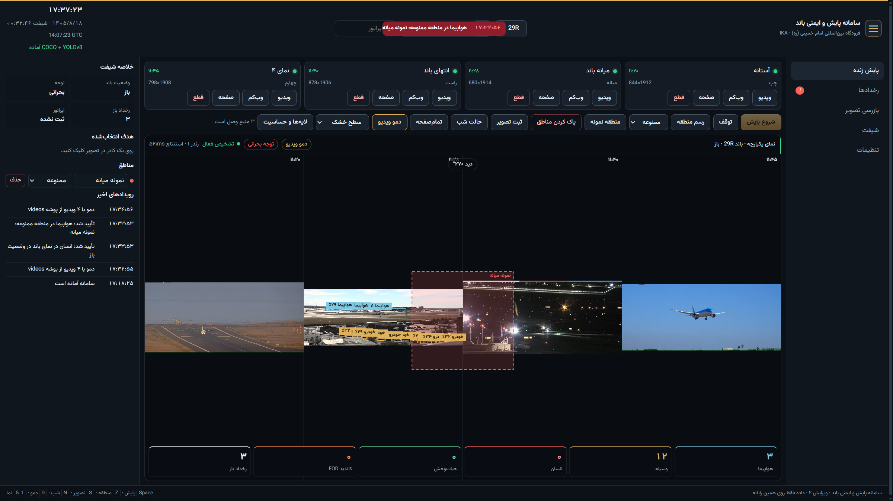
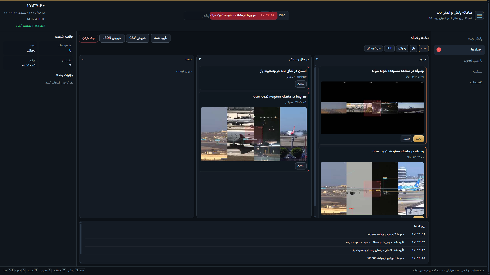
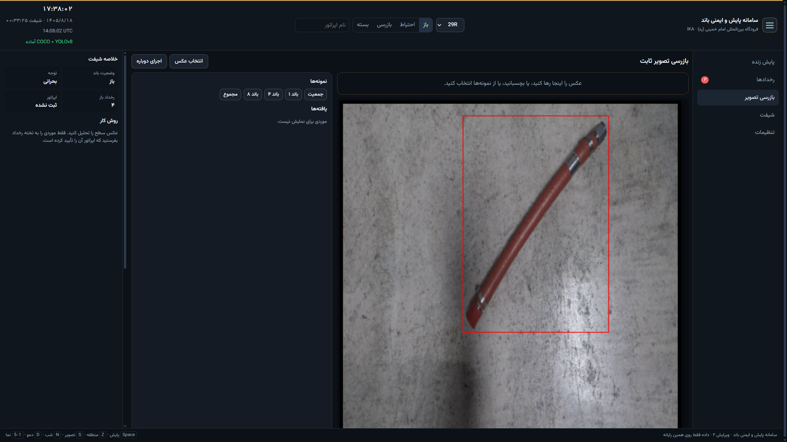
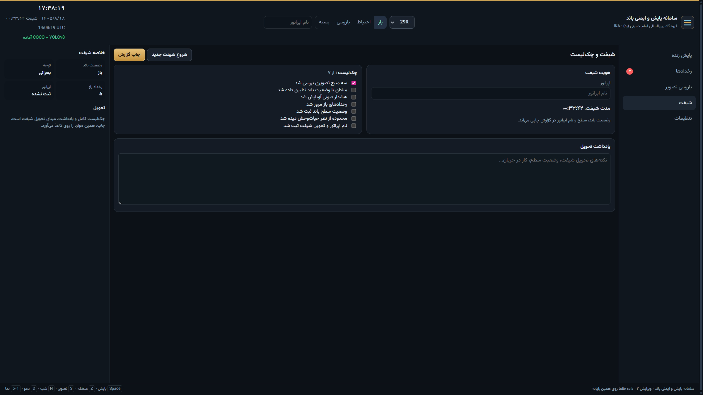
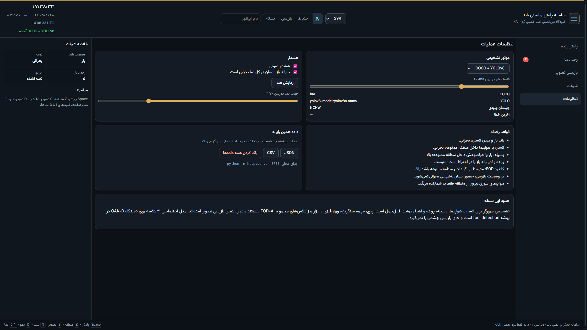

# سامانه پایش و ایمنی باند

A Persian, right-to-left runway operations console for Imam Khomeini International Airport (IKA). One HTML file watches up to four camera views, runs COCO-SSD and YOLOv8 in the browser, and turns what it sees into incidents, a shift checklist, and a printable handover.

Open `airport-monitor.html` through a local web server. The page is the product. The rest of this repository is the model it loads, the demo recordings, the earlier console, and the FOD research material the inspection view points to.

## Live monitor

Four airport recordings play together. A restricted zone sits on the middle pane, and the engine draws boxes for aircraft and vehicles while the runway state stays **باز** (open) on 29R.



The header carries the active runway (29R, 29L, 11L, 11R), the runway state, the operator name, Tehran time, UTC, and the shift clock. The engine pill reports when COCO and YOLOv8 are ready.

## Incident board

Every open threat becomes a card with a frame thumbnail. Columns are new, acknowledged, and closed. Acknowledge or close a card from the board; critical events also raise a modal that stays until the operator confirms it or chooses later.



Export the board as CSV or JSON. The newest 25 incident thumbnails and 15 log entries stay in the browser. Nothing is sent to a server.

## Still-image inspection

Drop in a surface photo, or open one of the bundled FOD samples. Findings are listed for review. An incident is filed only after the operator confirms it.



The sample above is a cable on concrete from the FOD-A examples. The browser models are built for people, aircraft, vehicles, birds, and coarse objects. Bolts, nuts, stones, metal sheet, and small tools are the 31 FOD-A classes. Those are reviewed by eye here, or with the separate OAK-D model in `fod-detection`.

## Shift handover

The shift view keeps the operator name, elapsed time, a seven-item checklist, and a free-text handover note. **چاپ گزارش** prints that pack with the runway state.



## Settings

Choose the engine (COCO + YOLOv8, COCO only, or YOLOv8 only), the detection interval, sound, and whether a person anywhere is critical while the runway is open. The same page lists the threat rules and the limits of this version.



## Run it locally

The ONNX model is loaded with `fetch`. Opening the file directly (`file://`) cannot do that, so serve the folder:

```bash
cd airport-runway-monitor
python -m http.server 8765
```

Then open [http://127.0.0.1:8765/airport-monitor.html](http://127.0.0.1:8765/airport-monitor.html).

The first load needs network access. TensorFlow.js, COCO-SSD, and ONNX Runtime Web come from jsDelivr. The YOLOv8n weights are local: `yolov8-model/yolov8n.onnx` (about 12 MB). A current Chrome, Edge, or Firefox build is enough. There is no install step and no backend.

Cameras, zones, incidents, the checklist, and the handover note are stored in `localStorage` under `ika_ops_v3` on this computer.

## Demo videos

**دمو ویدیو** (or the `D` key) reads every `.mp4` in `videos/`, plays up to four of them muted and looping, and turns monitoring on. The four recordings in this repository are:

| File | Clock on the pane | What it shows |
| --- | --- | --- |
| `Recording 2026-11-09 112008.mp4` | ۱۱:۲۰ | Wide apron with several aircraft |
| `Recording 2026-11-09 112835.mp4` | ۱۱:۲۸ | Close taxi of a Turkish Airlines jet |
| `Recording 2026-11-09 114012.mp4` | ۱۱:۴۰ | Night approach and landing |
| `Recording 2026-11-09 114536.mp4` | ۱۱:۴۵ | Tails along the terminal |

The files in `videos/` are playback copies scaled to 960 px wide (about 5–17 MB each), so each one stays under GitHub's 100 MB limit. `videos/originals/` is gitignored. The full-size 11:28 and 11:45 recordings are kept there and attached to the [release](https://github.com/omidram/airport-runway-monitor/releases). The full-size 11:20 and 11:40 recordings are no longer on disk; the playback copies are what remains for those two clips. The page only lists `.mp4` files directly inside `videos/`, so a subfolder is not picked up by the demo button.

## How a threat is raised

Detection walks the cameras in turn. COCO-SSD and YOLOv8 run together when fusion is selected. A box has to cover a real part of the frame, and a zone hit needs the box to overlap that zone by at least 30 percent.

| Situation | Severity |
| --- | --- |
| Person or airplane inside a restricted zone | Critical. A person during inspection or while the runway is closed is high. |
| Vehicle, FOD candidate, or wildlife inside a restricted zone | High |
| Runway open and a person anywhere in the view | Critical, when that option is on |
| Person in a caution zone | High, except during inspection |
| Airplane in a caution zone | High |
| Wildlife while the runway is open or in caution | Medium |
| FOD candidate | Medium, or low when the runway is closed |
| Vehicle in a caution zone while the runway is open | Medium |

An airplane that is only passing through, outside any zone, is counted and drawn. It does not open an incident. One open incident is kept per class and kind; a worse severity updates that card and can raise the critical modal again. Sound repeats while a critical incident is still open.

## Keyboard

| Key | Action |
| --- | --- |
| `Space` | Start or stop monitoring |
| `Z` | Draw a zone |
| `S` | Save a still |
| `N` | Night filter |
| `D` | Demo videos |
| `F` | Full screen |
| `1`–`5` | Switch views |

## Repository map

| Path | Role |
| --- | --- |
| `airport-monitor.html` | The operations console |
| `airport-monitor.legacy.html` | The previous single-file console, kept as a backup |
| `yolov8-model/` | YOLOv8n ONNX weights the console loads first |
| `videos/` | Demo recordings the **دمو ویدیو** button plays |
| `docs/screenshots/` | Images in this README |
| `coco-model/` | A local TensorFlow.js SSD graph kept with the workspace. The console loads COCO-SSD from the CDN. |
| `yolov8-onnx/` | Upstream React + ONNX Runtime Web demo ([Hyuto](https://github.com/Hyuto/yolov8-onnxruntime-web)). The console uses its ONNX file only as a fallback path. |
| `yolov8-browser/` | Upstream vanilla webcam demo. Same fallback role for the weights. |
| `fod-detection/` | Python training and OAK-D runtime for a 31-class YOLOv8n FOD model (`openvino_model/best.blob`). It needs an OAK-D device. |
| `fod-data/` | Sample images and tools from the [FOD-A dataset](https://github.com/FOD-UNOmaha/FOD-data) (Munyer et al.). The full dataset is downloaded separately; these examples feed the inspection view. |

`yolov8-onnx`, `yolov8-browser`, `fod-detection`, and `fod-data` keep their own licenses and READMEs. This console does not replace that research code.

## Credits

IKA runway designators in the header follow 11L/11R and 29L/29R. Camera look angle is separate and defaults to 270°. FOD class names follow the FOD-A label set used by `fod-detection`.
